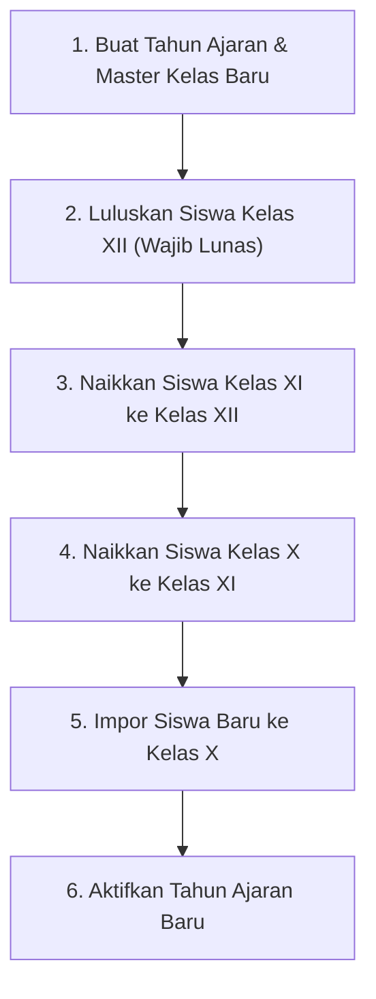

# 📚 BUKU PANDUAN PENGGUNAAN SISTEM INFORMASI SPP & KEUANGAN SEKOLAH (E-SPP)

Selamat datang di Buku Panduan Penggunaan Sistem Informasi Pembayaran SPP dan Pengelolaan Keuangan Sekolah (**E-SPP**). Panduan ini dirancang untuk memandu seluruh pengguna—mulai dari **Administrator**, **Petugas Kasir / Bendahara**, **Wali Kelas**, hingga **Siswa / Orang Tua Murid**—dalam mengoperasikan seluruh fitur sistem secara efektif, akurat, dan akuntabel.

---

## DAFTAR ISI

- [BAB 1: Pengenalan & Hak Akses Pengguna](#bab-1-pengenalan--hak-akses-pengguna)
  - [1.1 Gambaran Umum Sistem](#11-gambaran-umum-sistem)
  - [1.2 Struktur Peran Pengguna (User Roles)](#12-struktur-peran-pengguna-user-roles)
  - [1.3 Login & Keamanan Akun](#13-login--keamanan-akun)
  - [1.4 Manajemen Role & Hak Akses Modul](#14-manajemen-role--hak-akses-modul)
- [BAB 2: Panduan Awal Tahun Ajaran (Setup Master Data)](#bab-2-panduan-awal-tahun-ajaran-setup-master-data)
  - [2.1 Profil & Kop Sekolah](#21-profil--kop-sekolah)
  - [2.2 Tahun Ajaran](#22-tahun-ajaran)
  - [2.3 Kompetensi Keahlian (Jurusan)](#23-kompetensi-keahlian-jurusan)
  - [2.4 Data Kelas (Rombongan Belajar)](#24-data-kelas-rombongan-belajar)
  - [2.5 Tarif SPP & Biaya Non-SPP](#25-tarif-spp--biaya-non-spp)
  - [2.6 Impor Data Siswa Massal via Excel](#26-impor-data-siswa-massal-via-excel)
- [BAB 3: Transaksi Kasir & Penerimaan Keuangan](#bab-3-transaksi-kasir--penerimaan-keuangan)
  - [3.1 Loket Kasir Cepat (POS Mode)](#31-loket-kasir-cepat-pos-mode)
  - [3.2 Entri Pembayaran Standar](#32-entri-pembayaran-standar)
  - [3.3 Pembayaran Gabungan / Kolektif Satu Kelas](#33-pembayaran-gabungan--kolektif-satu-kelas)
  - [3.4 Kuitansi Pembayaran & Timestamps Resmi](#34-kuitansi-pembayaran--timestamps-resmi)
  - [3.5 Verifikasi Keaslian Kuitansi via QR Code](#35-verifikasi-keaslian-kuitansi-via-qr-code)
  - [3.6 Pembatalan Transaksi (Void)](#36-pembatalan-transaksi-void)
- [BAB 4: Operasional Pengeluaran Kas Sekolah](#bab-4-operasional-pengeluaran-kas-sekolah)
  - [4.1 Pencatatan Belanja Kas Operasional](#41-pencatatan-belanja-kas-operasional)
  - [4.2 Unggah Bukti Nota / Faktur Fisik](#42-unggah-bukti-nota--faktur-fisik)
  - [4.3 Cetak Voucher Bukti Kas Keluar](#43-cetak-voucher-bukti-kas-keluar)
  - [4.4 Cetak Rekapitulasi Pengeluaran Kas](#44-cetak-rekapitulasi-pengeluaran-kas)
- [BAB 5: Subsidi Biaya & Beasiswa Siswa](#bab-5-subsidi-biaya--beasiswa-siswa)
  - [5.1 Subsidi Tarif Persentase (Diskon n%)](#51-subsidi-tarif-persentase-diskon-n)
  - [5.2 Siswa Ditanggung Pemerintah (PIP / BOSP / Pemda)](#52-siswa-ditanggung-pemerintah-pip--bosp--pemda)
- [BAB 6: Siklus Akhir Tahun Ajaran (Kelulusan & Kenaikan Kelas)](#bab-6-siklus-akhir-tahun-ajaran-kelulusan--kenaikan-kelas)
  - [6.1 Prinsip Kerja Top-Down](#61-prinsip-kerja-top-down)
  - [6.2 Prosedur Kelulusan Tingkat Akhir (Kelas XII)](#62-prosedur-kelulusan-tingkat-akhir-kelas-xii)
  - [6.3 Prosedur Kenaikan Kelas Massal](#63-prosedur-kenaikan-kelas-massal)
  - [6.4 Fitur Pembatalan Batch (Rollback Batch)](#64-fitur-pembatalan-batch-rollback-batch)
- [BAB 7: Laporan Keuangan, Buku Besar & Rekapitulasi](#bab-7-laporan-keuangan-buku-besar--rekapitulasi)
  - [7.1 Laporan Pembayaran (Pemasukan Kasir)](#71-laporan-pembayaran-pemasukan-kasir)
  - [7.2 Laporan Pengeluaran Sekolah](#72-laporan-pengeluaran-sekolah)
  - [7.3 Laporan Tunggakan & Cetak Distribusi Wali Kelas](#73-laporan-tunggakan--cetak-distribusi-wali-kelas)
  - [7.4 Kartu Pembayaran Siswa (Student Ledger / Buku Besar)](#74-kartu-pembayaran-siswa-student-ledger--buku-besar)
  - [7.5 Rekap Potensi Penerimaan vs Realisasi](#75-rekap-potensi-penerimaan-vs-realisasi)
  - [7.6 Laporan Ditanggung Pemerintah](#76-laporan-ditanggung-pemerintah)
  - [7.7 Audit Trail & Log Aktivitas](#77-audit-trail--log-aktivitas)
- [BAB 8: Panduan Portal Mandiri Siswa / Orang Tua](#bab-8-panduan-portal-mandiri-siswa--orang-tua)
  - [8.1 Akses Portal Siswa](#81-akses-portal-siswa)
  - [8.2 Memeriksa Tagihan & Tunggakan SPP](#82-memeriksa-tagihan--tunggakan-spp)
  - [8.3 Riwayat Pembayaran & Cetak Kuitansi Mandiri](#83-riwayat-pembayaran--cetak-kuitansi-mandiri)
- [BAB 9: Tanya Jawab (FAQ) & Solusi Permasalahan](#bab-9-tanya-jawab-faq--solusi-permasalahan)

---

# BAB 1: Pengenalan & Hak Akses Pengguna

### 1.1 Gambaran Umum Sistem
Aplikasi E-SPP adalah platform modern pengelolaan keuangan pendidikan yang mengintegrasikan loket kasir kas cepat (*Point of Sale*), manajemen piutang/tunggakan multi-tahun, verifikasi kuitansi digital anti-palsu dengan QR Code, serta pembukuan arus kas (penerimaan dan pengeluaran kas operasional).

### 1.2 Struktur Peran Pengguna (User Roles)
Sistem membagi pengguna ke dalam 4 peran dengan tanggung jawab khusus:

| Peran (*Role*) | Deskripsi Tanggung Jawab |
|---|---|
| **Administrator (`admin`)** | Pejabat pengelola sistem utama. Bertanggung jawab atas pengaturan awal tahun ajaran, profil sekolah, master kelas, penetapan tarif, manajemen pengguna, hak akses, otorisasi pembatalan transaksi (*void*), dan audit log aktivitas. |
| **Petugas / Kasir (`petugas`)** | Staf tata usaha / bendahara sekolah. Bertanggung jawab atas pelayanan loket kasir pembayaran siswa, pencatatan pembayaran kolektif, pencatatan belanja pengeluaran kas, serta mencetak laporan penerimaan dan pengeluaran harian. |
| **Wali Kelas (`wali_kelas`)** | Guru yang ditugaskan membina rombongan belajar tertentu. Memiliki hak akses khusus untuk memantau status tunggakan siswa binaannya dan mencetak lembar tagihan kelas. |
| **Siswa (`siswa`)** | Siswa aktif atau orang tua/wali murid. Mengakses Portal Mandiri untuk melihat kartu SPP 12 bulan, riwayat pembayaran, serta mencetak ulang kuitansi pembayaran resmi. |

### 1.3 Login & Keamanan Akun
1. Buka browser dan arahkan ke alamat URL aplikasi SPP (contoh: `https://spp.sekolah.sch.id/admin`).
2. Masukkan **Email / Username** dan **Kata Sandi**.
3. **Login Google**: Jika akun sekolah telah terintegrasi dengan Google Workspace, klik tombol **"Masuk dengan Google"** untuk login instan tanpa mengetik sandi.
4. **Ganti Kata Sandi**: Untuk menjaga keamanan, klik nama profil di pojok kanan atas > pilih **Profil Saya** untuk memperbarui kata sandi secara berkala.

### 1.4 Manajemen Role & Hak Akses Modul
*(Menu: **Pengaturan & Akses > Manajemen Role**)*
Admin dapat menyesuaikan hak akses modul secara dinamis tanpa perlu mengubah kode aplikasi:
- Tersedia opsi toggle izin untuk masing-masing peran: `Kesiswaan`, `Kasir / Entri Pembayaran`, `Void Transaksi`, `Pengeluaran Operasional`, `Laporan Keuangan`, dan `Pengaturan Sistem`.
- Klik tombol **"Simpan Hak Akses"** untuk memberlakukan perubahan.

---

# BAB 2: Panduan Awal Tahun Ajaran (Setup Master Data)

Sebelum memulai transaksi pembayaran pada tahun ajaran baru, lakukan pengaturan data master secara berurutan:

```
Profil Sekolah ➔ Tahun Ajaran Baru ➔ Kompetensi Keahlian ➔ Data Kelas ➔ Tarif SPP & Biaya ➔ Impor/Input Siswa
```

### 2.1 Profil & Kop Sekolah
*(Menu: **Pengaturan & Akses > Profil & Kop Sekolah**)*
1. Masukkan **Nama Resmi Sekolah**, **NPSN**, **Alamat Lengkap**, **Nomor Telepon**, dan **Email Resmi**.
2. Masukkan **Nama Kepala Sekolah & NIP** serta **Nama Bendahara / Kasir & NIP**. Informasi ini akan tercetak otomatis pada lembar kuitansi, voucher pengeluaran, dan laporan resmi.
3. Unggah **Logo Sekolah** berformat PNG/JPG transparan. Logo ini akan menghiasi kuitansi dan kop cetak surat.
4. Isi **Catatan Kuitansi**: Pesan himbauan untuk orang tua (misal: *"Simpan kuitansi ini sebagai bukti pembayaran sah"*).
5. Klik **Simpan Perubahan**.

### 2.2 Tahun Ajaran
*(Menu: **Master Data > Tahun Ajaran**)*
1. Klik tombol **Tambah Tahun Ajaran**.
2. Masukkan nama tahun ajaran (contoh: `2026/2027`).
3. Tentukan **Tanggal Mulai** (biasanya 1 Juli) dan **Tanggal Selesai** (30 Juni tahun berikutnya).
4. Tandai **Aktif = Ya** pada tahun ajaran yang sedang berjalan.
5. Klik **Simpan**.
> [!IMPORTANT]
> Sistem hanya mengizinkan **1 Tahun Ajaran Aktif**. Mengaktifkan tahun ajaran baru akan otomatis menonaktifkan tahun ajaran sebelumnya.

### 2.3 Kompetensi Keahlian (Jurusan)
*(Menu: **Master Data > Kompetensi Keahlian**)*
1. Klik **Tambah Kompetensi Keahlian**.
2. Masukkan **Kode Jurusan** (contoh: `RPL`, `TKJ`, `AKL`, `DPIB`) dan **Nama Jurusan** lengkap.
3. Klik **Simpan**.

### 2.4 Data Kelas (Rombongan Belajar)
*(Menu: **Master Data > Data Kelas**)*
1. Klik **Tambah Kelas**.
2. Masukkan **Nama Kelas** (contoh: `X RPL 1`, `XI TKJ 2`, `XII AKL 1`).
3. Pilih **Tingkat** (`10`, `11`, `12` untuk SMK/SMA; `7`, `8`, `9` untuk SMP; `1` s/d `6` untuk SD).
4. Pilih **Kompetensi Keahlian (Jurusan)** terkait.
5. Pilih **Wali Kelas**: Pilih staf/guru yang bertindak sebagai wali kelas rombel tersebut.
6. Klik **Simpan**.

### 2.5 Tarif SPP & Biaya Non-SPP
*(Menu: **Master Data > Tarif & Kategori**)*
Sistem membedakan dua jenis tagihan:

1. **Tarif SPP Bulanan**:
   - Klik **Tambah Tarif SPP**.
   - Masukkan **Tahun Ajaran** dan **Tingkat Kelas** (misal Tingkat 10 Tahun 2026/2027).
   - Masukkan **Nominal SPP per Bulan** (contoh: `Rp 250.000`).
   - Tagihan ini otomatis berlaku 12 bulan (Juli s/d Juni).

2. **Biaya Non-SPP (Uang Gedung, Seragam, Ujian, dll.)**:
   - Klik **Tambah Kategori Biaya Non-SPP**.
   - Masukkan **Nama Biaya** (contoh: `Uang Pangkal / Gedung`, `Paket Seragam Sekolah`, `Ujian Akhir Semester`).
   - Tentukan **Tipe Biaya**:
     - *Sekali Bayar*: Ditagihkan satu kali selama menjadi siswa (dapat dicicil).
     - *Tahunan / Per Tingkat*: Ditagihkan sekali setiap tahun ajaran.
     - *Bulanan*: Ditagihkan setiap bulan di luar SPP reguler.
   - Masukkan nominal tarif standar dan tentukan tingkat kelas sasarannya.

### 2.6 Impor Data Siswa Massal via Excel
*(Menu: **Kesiswaan > Impor Siswa**)*
Gunakan fitur ini untuk memasukkan data ratusan siswa baru sekaligus dengan aman melalui sistem verifikasi dua tahap (*Staging*):

1. **Unduh Template**: Klik tautan **"Unduh Template Excel"**. Template telah berisi 3 lembar kerja:
   - *Data Siswa*: Lembar isian data.
   - *Referensi*: Berisi daftar kode kelas dan jurusan yang sah di sistem.
   - *Petunjuk*: Petunjuk pengisian tiap kolom.
2. **Pengisian Kolom Excel**:
   - Kolom Wajib: `NIS`, `NISN`, `Nama Siswa`, `Jenis Kelamin` (L/P), `Kelas`, `Jurusan`.
   - Kolom Kontak: `Nomor HP Orang Tua`, `Alamat`.
   - Kolom **Potongan (%)**: Jika siswa memiliki keringanan/subsidi, isi persentasenya (misal: `50` atau `50%` atau pecahan desimal `0.5`). Siswa reguler dikosongkan atau diisi `0`.
3. **Unggah Berkas**: Pilih file Excel yang telah diisi, lalu klik **"Unggah & Periksa ke Staging"**.
4. **Verifikasi Staging**:
   - Sistem akan memeriksa baris demi baris.
   - Baris berstatus **Hijau (Valid)** siap dimasukkan ke database.
   - Baris berstatus **Merah (Error)** akan menampilkan alasan penolakan (misal NISN ganda, nama kelas tidak ditemukan). Perbaiki data bila ada yang salah.
5. **Simpan Siswa**: Klik tombol **"Eksekusi Simpan Siswa ke Database"**.
   - Akun portal siswa akan dibuat otomatis.
   - Data potongan/subsidi akan otomatis terdaftar di tabel subsidi siswa.

---

# BAB 3: Transaksi Kasir & Penerimaan Keuangan

### 3.1 Loket Kasir Cepat (POS Mode)
*(Menu: **Transaksi SPP > Entry Pembayaran**)*
Modul ini didesain menyerupai mesin kasir modern (*Point of Sale*) untuk mempercepat transaksi di loket tata usaha:

```
1. Cari Siswa ➔ 2. Cek Visual 12 Bulan ➔ 3. Klik Bulan / Pos ➔ 4. Konfirmasi & Diskon ➔ 5. Cetak Kuitansi
```

#### Langkah-langkah Transaksi:
1. **Cari Siswa**: Ketik nama siswa, NIS, atau NISN pada kolom pencarian cepat. Sistem akan menampilkan saran otomatis (*auto-suggest*). Klik nama siswa yang dituju.
2. **Pemeriksaan Visual Kartu SPP 12 Bulan**:
   - Grid 12 bulan (Juli s/d Juni) langsung tersaji di layar.
   - **Badge Hijau**: Bulan yang sudah lunas.
   - **Badge Netral / Abu-abu**: Bulan yang belum dibayar.
   - **Badge Kuning / Biru**: Pembayaran cicilan (menampilkan sisa tunggakan).
3. **Peringatan Tunggakan Tahun Lalu**:
   - Jika siswa memiliki sisa tunggakan dari tahun ajaran sebelumnya, sistem akan memunculkan banner peringatan merah: *"Siswa memiliki tunggakan tahun ajaran sebelumnya sebesar Rp xxx"*.
   - Kasir dapat langsung mengklik opsi pelunasan tunggakan lama tersebut.
4. **Pilih Tagihan yang Akan Dibayar**:
   - Klik langsung pada kotak bulan yang ingin dibayar (bisa memilih beberapa bulan sekaligus, misal: Juli, Agustus, dan September).
   - Pada panel sebelah kanan (Biaya Non-SPP), centang pos biaya lain yang ingin dilunasi bersamaan (misal Seragam atau Ujian).
5. **Pembayaran Cicilan (Parsial)**:
   - Jika orang tua hanya membayar sebagian dari nominal tagihan, klik tombol **"Cicil / Parsial"** pada item terkait dan ketik nominal yang disetorkan. Sisa tagihan akan otomatis disimpan sistem sebagai piutang.
6. **Modal Konfirmasi Pembayaran**:
   - Klik tombol **"Bayar Sekarang"**.
   - Muncul jendela modal konfirmasi rincian pembayaran.
   - Jika siswa memiliki subsidi, modal secara transparan mencantumkan uraian diskon, misalnya: `Juli 2026 (Diskon 50%) - Rp 125.000`.
7. **Pilih Metode Pembayaran**:
   - Pilih **Tunai**, **Transfer Bank**, atau **QRIS**.
8. **Simpan Transaksi**:
   - Klik **"Konfirmasi & Proses Pembayaran"**.
   - Transaksi tersimpan dan jendela pratinjau kuitansi otomatis muncul.

### 3.2 Entri Pembayaran Standar
*(Menu: **Transaksi SPP > Entri Pembayaran**)*
Formulir alternatif bagi staf yang lebih menyukai input manual berbasis dropdown satuan.

### 3.3 Pembayaran Gabungan / Kolektif Satu Kelas
*(Menu: **Transaksi SPP > History Pembayaran Kolektif**)*
Fitur ini digunakan saat Ketua Kelas atau Wali Kelas menyetorkan uang SPP titipan dari banyak siswa sekaligus:
1. Klik tombol **"Entri Pembayaran Kolektif"**.
2. Pilih **Kelas** dan tentukan **Metode Pembayaran**.
3. Centang siswa-siswa yang ikut menyetor.
4. Pilih bulan yang dibayarkan.
   - *Keunggulan Sistem*: Pilihan bulan telah dikelompokkan secara rapi per **Semester Gasal & Genap / Tahun Kalender**.
   - *Proteksi Pembayaran Ganda*: Sistem secara cerdas **otomatis menyembunyikan bulan yang sudah lunas** pada seluruh siswa terpilih, sehingga tidak ada risiko salah input dua kali.
5. Klik **"Proses Pembayaran Kolektif"**. Sistem akan membuat bukti transaksi gabungan sekaligus memperbarui kartu SPP masing-masing siswa.

### 3.4 Kuitansi Pembayaran & Timestamps Resmi
Setelah pembayaran berhasil, kasir dapat mencetak kuitansi resmi sekolah:
- **Standar Format**: Tersedia opsi cetak struk kasir thermal (80mm/58mm) maupun lembar nota A5.
- **Terbilang Rupiah**: Nominal total otomatis dikonversi menjadi kalimat terbilang bahasa Indonesia (contoh: *Dua Ratus Lima Puluh Ribu Rupiah*).
- **Catatan Subsidi**: Item yang mendapat subsidi tercetak dengan keterangan kecil: `* Potongan subsidi/diskon n%`.
- **Waktu Transaksi Lengkap (Timestamps WIB)**:
  - Header kuitansi mencantumkan `Waktu Transaksi: HH:mm:ss WIB`.
  - Catatan kaki mencantumkan: `* Kuitansi ini sah diterbitkan oleh sistem sekolah pada d F Y H:i:s WIB.`

### 3.5 Verifikasi Keaslian Kuitansi via QR Code
Setiap lembar kuitansi dilengkapi **QR Code Otentikasi Digital** yang dienkripsi dengan algoritma HMAC-SHA256:
- Orang tua, kasir, atau bagian keuangan dapat memindai (scan) QR Code tersebut menggunakan kamera ponsel tanpa memerlukan login.
- Tautan akan membuka halaman verifikasi resmi sistem yang menampilkan nomor kuitansi, nama siswa, nominal pembayaran, tanggal/jam bayar, dan status keabsahan dokumen. Kuitansi palsu atau hasil manipulasi foto tidak akan lolos verifikasi.

### 3.6 Pembatalan Transaksi (Void)
*(Menu: **Transaksi SPP > History Pembayaran**)*
Jika kasir melakukan kesalahan fatal (salah input nominal, salah memilih nama siswa, atau uang dibatalkan penyetor):
1. Transaksi hanya dapat dibatalkan oleh pengguna dengan peran **Administrator**.
2. Cari transaksi pada tabel riwayat pembayaran, lalu klik tombol **"Void / Batalkan"**.
3. Masukkan **Alasan Pembatalan** secara jelas dan jujur (alasan ini akan tersimpan permanen di riwayat audit).
4. Klik konfirmasi.
5. Efek pembatalan:
   - Status transaksi berubah menjadi `VOID` (tidak dihitung dalam kas masuk).
   - Status tagihan siswa terkait otomatis dikembalikan menjadi **Belum Lunas**.
   - Riwayat pembatalan dicatat di **Log Aktivitas**.

---

# BAB 4: Operasional Pengeluaran Kas Sekolah

Untuk menjaga keseimbangan arus kas (*cash flow*), sistem menyediakan pembukuan pengeluaran operasional:

### 4.1 Pencatatan Belanja Kas Operasional
*(Menu: **Transaksi SPP > Transaksi Pengeluaran Operasional Sekolah**)*
1. Klik tombol **Tambah Pengeluaran**.
2. Sistem akan mengalokasikan **Nomor Bukti Otomatis** berformat `EXP-YYYYMMDD-XXXX`.
3. Masukkan **Tanggal Pengeluaran**.
4. Pilih **Kategori Belanja**:
   - `ATK & Perlengkapan Kantor`
   - `Sarana & Prasarana Sekolah`
   - `Gaji & Honor Pegawai / Guru`
   - `Utilitas (Listrik, Air, Internet)`
   - `Konsumsi & Operasional Rapat`
   - `Kegiatan Kesiswaan & Lomba`
   - `Lain-lain`
5. Masukkan **Nominal Pengeluaran** dan **Nama Penerima Dana**.
6. Tulis **Uraian / Keterangan Belanja** secara terperinci.

### 4.2 Unggah Bukti Nota / Faktur Fisik
Pada formulir pengeluaran, lampirkan foto atau scan nota/bon/kuitansi asli toko dalam format JPG/PNG/PDF agar pertanggungjawaban keuangan akuntabel.

### 4.3 Cetak Voucher Bukti Kas Keluar
Setelah disimpan, klik tombol **"Cetak Bukti Kas Keluar"** untuk mencetak voucher pengeluaran resmi:
- Voucher berisi rincian dana, nomor bukti, tanggal transaksi, dan 3 kolom tanda tangan otorisasi: **Kasir / Bendahara**, **Penerima Dana**, dan **Mengetahui Kepala Sekolah**.

### 4.4 Cetak Rekapitulasi Pengeluaran Kas
*(Menu: **Laporan > Laporan Pengeluaran**)*
Gunakan menu ini untuk mencetak rekapitulasi realisasi belanja kas sekolah berdasarkan rentang tanggal tertentu atau per kategori pengeluaran.

---

# BAB 5: Subsidi Biaya & Beasiswa Siswa

### 5.1 Subsidi Tarif Persentase (Diskon n%)
Sistem mendukung kebijakan keringanan biaya sekolah (anak guru, beasiswa prestasi, keluarga prasejahtera, dsb.):
1. Buka menu **Kesiswaan > Data Siswa**.
2. Klik tombol **Edit** pada siswa yang bersangkutan, lalu buka tab **Subsidi Siswa** (atau langsung diinput saat impor Excel).
3. Klik **Tambah Subsidi**:
   - **Persentase Potongan**: Masukkan persentase diskon (1% s/d 100%). Contoh: jika SPP Rp 200.000 dan diskon 50%, maka tagihan siswa menjadi Rp 100.000.
   - **Cakupan Potongan**:
     - *SPP Saja*: Potongan hanya berlaku pada SPP bulanan.
     - *Non-SPP Saja*: Potongan hanya berlaku pada biaya sarana/gedung/seragam.
     - *Global*: Potongan berlaku untuk seluruh tagihan siswa di sekolah.
   - **Jenis Subsidi**: Pilih kategori (Anak Pendidik/Tenaga Kependidikan, Prestasi Akademik/Non-Akademik, Afirmasi/Yatim, Beasiswa Yayasan, atau Khusus).
   - **Keterangan**: Catatan nomor SK atau disposisi kepala sekolah.
4. Klik **Simpan**.
> [!NOTE]
> Pemotongan nominal berjalan otomatis di Loket Kasir, Laporan Tunggakan, hingga Bukti Cetak Kuitansi tanpa kasir perlu menghitung diskon secara manual.

### 5.2 Siswa Ditanggung Pemerintah (PIP / BOSP / Pemda)
*(Menu: **Kesiswaan > Data Siswa > Tab Tanggungan Pemerintah**)*
Untuk siswa penerima bantuan penuh dari pemerintah:
1. Tambahkan data tanggungan: tentukan apakah bantuan menanggung SPP penuh atau pos biaya tertentu.
2. Masukkan **Tanggal Mulai Berlaku** dan **Tanggal Berakhir**.
3. Tagihan siswa pada periode tersebut otomatis dialihkan statusnya menjadi `ditanggung_pemerintah`, sehingga tidak menagih orang tua siswa di loket kasir.

---

# BAB 6: Siklus Akhir Tahun Ajaran (Kelulusan & Kenaikan Kelas)

Pada akhir semester genap saat pergantian tahun ajaran, sekolah perlu memproses siswa yang lulus dan menaikkan tingkat siswa kelas bawah.

### 6.1 Prinsip Kerja Top-Down
Sistem E-SPP menggunakan aturan baku **Top-Down (Tingkat Atas ke Tingkat Bawah)**:



> [!WARNING]
> **Mengapa Kelas XII Wajib Diluluskan Terlebih Dahulu?**
> Jika Anda menaikkan kelas XI ke XII sebelum meluluskan siswa kelas XII lama, rombel kelas XII akan tercampur antara siswa lama dan siswa baru naik. Meluluskan kelas XII terlebih dahulu akan mengarsipkan siswa lama dan mengosongkan rombel XII.

---

### 6.2 Prosedur Kelulusan Tingkat Akhir (Kelas XII)
*(Menu: **Kesiswaan > Kelulusan**)*

1. **Pilih Filter**:
   - Pilih **Tahun Ajaran** yang sedang berjalan.
   - Pilih **Kelas Tingkat Akhir** (misal: `XII RPL 1`).
   - Masukkan **Tanggal Lulus** resmi.
2. **Pemeriksaan Bebas Tunggakan**:
   - Sistem secara otomatis memeriksa riwayat keuangan seluruh siswa di kelas tersebut.
   - Siswa yang **Bebas Tunggakan (Lunas 100%)** akan otomatis tercentang hijau.
   - Siswa yang **Masih Menunggak** ditandai merah beserta rincian rupiah tunggakannya.
> [!CAUTION]
> **Proteksi Kelulusan**: Sistem menolak meluluskan siswa yang masih memiliki tunggakan SPP/Non-SPP. Siswa wajib melunasi tunggakan di kasir terlebih dahulu agar dapat diluluskan.
3. **Pratinjau Kelulusan**: Klik **"Pratinjau Kelulusan"** untuk memastikan jumlah siswa yang memenuhi syarat.
4. **Eksekusi Kelulusan**: Klik **"Proses Kelulusan Siswa"**.
   - Status siswa berubah menjadi `lulus`.
   - Siswa otomatis diarsipkan (`is_archived = true`), sehingga rombel XII menjadi bersih dan siap menerima siswa baru naik dari kelas XI.

---

### 6.3 Prosedur Kenaikan Kelas Massal
*(Menu: **Kesiswaan > Kenaikan Kelas**)*

Lakukan proses ini bertahap: pertama dari **Kelas XI naik ke XII**, kemudian dari **Kelas X naik ke XI**.

1. **Pilih Tahun Ajaran & Kelas Asal**:
   - **Tahun Ajaran Asal**: Tahun ajaran yang sedang berjalan (misal: 2025/2026).
   - **Tahun Ajaran Tujuan**: Tahun ajaran baru berikutnya (misal: 2026/2027).
   - **Kelas Asal**: Pilih kelas yang akan dinaikkan (misal: `XI RPL 1`).
2. **Pemetaan Kelas Tujuan Batch Otomatis**:
   - Sistem secara cerdas memprediksi kelas tujuan yang setingkat lebih tinggi dengan jurusan yang sama (contoh: `XI RPL 1` otomatis dipetakan ke `XII RPL 1`).
   - Kasir/operator juga dapat memilih kelas tujuan lain jika terjadi perombakan rombel.
3. **Penetapan Keputusan Siswa**:
   - Secara default, seluruh siswa diset **Naik Kelas**.
   - Untuk siswa yang **Tinggal Kelas**, ubah opsi statusnya menjadi `Tinggal Kelas`. Sistem otomatis memetakan siswa tersebut ke kelas dengan tingkat yang sama di tahun ajaran baru.
4. **Perlakuan Tunggakan Siswa**:
   - Berbeda dengan kelulusan, **siswa yang masih memiliki tunggakan tetap diizinkan naik kelas**.
   - Seluruh sisa tunggakan dari tahun ajaran lama tidak akan hilang, melainkan **otomatis terbawa ke tahun ajaran baru** dan tetap ditagihkan di kasir.
5. **Pratinjau & Eksekusi**:
   - Klik **"Pratinjau Kenaikan Kelas"**.
   - Jika data sudah sesuai, klik **"Simpan Kenaikan Kelas Sekarang"**.
   - Sistem memperbarui kelas siswa, menetapkan tarif SPP tingkat baru, dan mencatat riwayat kelas (*riwayat_kelas*).

---

### 6.4 Fitur Pembatalan Batch (Rollback Batch)
Jika staf melakukan kesalahan pemilihan kelas tujuan atau salah tahun ajaran saat memproses kenaikan kelas:
1. Buka tabel **Riwayat Batch Kenaikan Kelas** di bagian bawah halaman Kenaikan Kelas.
2. Cari nomor batch yang bersangkutan.
3. Klik tombol **"Batalkan Batch"**.
4. Sistem akan mengembalikan posisi rombel dan tarif seluruh siswa di batch tersebut ke keadaan semula sebelum proses dilakukan.
> [!NOTE]
> Pembatalan batch hanya diizinkan selama **belum ada transaksi pembayaran baru** yang dicatat untuk siswa di tahun ajaran tujuan.

---

# BAB 7: Laporan Keuangan, Buku Besar & Rekapitulasi

### 7.1 Laporan Pembayaran (Pemasukan Kasir)
*(Menu: **Laporan > Laporan Pembayaran**)*
- Memantau seluruh uang masuk dari SPP dan biaya non-SPP.
- Dilengkapi filter fleksibel: rentang tanggal bayar, metode pembayaran (Tunai/Transfer/QRIS), petugas kasir, pos biaya, dan tingkat kelas.
- Dilengkapi badge penanda diskon/subsidi.
- Klik **"Cetak Laporan"** untuk cetak fisik atau **"Ekspor Excel"** untuk pengolahan data akuntansi lebih lanjut.

### 7.2 Laporan Pengeluaran Sekolah
*(Menu: **Laporan > Laporan Pengeluaran**)*
- Rekapitulasi belanja kas operasional sekolah per periode.
- Membantu pimpinan sekolah membandingkan arus kas masuk (pembayaran SPP) dengan arus kas keluar (operasional).

### 7.3 Laporan Tunggakan & Cetak Distribusi Wali Kelas
*(Menu: **Laporan > Laporan Tunggakan**)*
- Menyajikan daftar siswa yang belum melunasi kewajiban keuangannya.
- **Fitur Cetak Tunggakan per Kelas**:
  - Disediakan tombol cetak khusus yang memisahkan lembar per rombel kelas (*page-break* otomatis).
  - Lembar ini dapat langsung disobek/dibagikan kepada masing-masing Wali Kelas saat rapat koordinasi bulanan untuk memudahkan penagihan ke orang tua siswa.
  - Perhitungan tunggakan di laporan ini akurat karena telah memperhitungkan potongan diskon subsidi dan tanggal resmi siswa masuk sekolah.

### 7.4 Kartu Pembayaran Siswa (Student Ledger / Buku Besar)
*(Menu: **Laporan > Kartu Pembayaran Siswa**)*
- Menampilkan buku besar keuangan individu siswa secara menyeluruh selama bersekolah (mencakup data dari kelas 10, 11, hingga 12).
- Menampilkan riwayat transaksi per tanggal, nomor kuitansi, nama kasir penerima, serta sisa kewajiban.
- Dapat dicetak sebagai lembar buku pembayaran resmi saat orang tua meminta rekapitulasi pembayaran siswa.

### 7.5 Rekap Potensi Penerimaan vs Realisasi
*(Menu: **Laporan > Rekap Potensi Penerimaan**)*
- Menghitung target total penerimaan SPP tahun ajaran berjalan (jumlah siswa aktif dikalikan tarif SPP).
- Membandingkan target potensi dengan realisasi kas yang sudah masuk, nilai potongan subsidi, serta sisa piutang tertunggak.

### 7.6 Laporan Ditanggung Pemerintah
*(Menu: **Laporan > Ditanggung Pemerintah**)*
- Merekapitulasi total bantuan beasiswa (PIP, Pemda, Yayasan) yang diserap siswa sekolah beserta rincian pos biayanya.

### 7.7 Audit Trail & Log Aktivitas
*(Menu: **Pengaturan & Akses > Log Aktivitas**)*
- Seluruh tindakan krusial pengguna terekam otomatis demi transparansi:
  - Siapa yang melakukan transaksi kasir dan kapan jamnya.
  - Siapa yang membatalkan transaksi (*void*) beserta alasan pembatalannya.
  - Siapa yang mengeksekusi kenaikan kelas, kelulusan, atau impor data siswa.

---

# BAB 8: Panduan Portal Mandiri Siswa / Orang Tua

Sistem menyediakan antarmuka khusus bagi siswa dan orang tua agar dapat memantau administrasi sekolah secara transparan dari rumah:

### 8.1 Akses Portal Siswa
1. Arahkan browser ke alamat portal siswa (atau menu **Portal Siswa** di panel).
2. Siswa/orang tua masuk menggunakan **NISN** dan kata sandi yang telah dibagikan pihak sekolah.

### 8.2 Memeriksa Tagihan & Tunggakan SPP
*(Menu: **Portal Siswa > Status Tagihan per siswa**)*
- Siswa dapat melihat tampilan visual kartu SPP 12 bulan mereka.
- Rincian bulan mana saja yang sudah lunas dan bulan mana yang masih menjadi kewajiban terpampang secara jelas.
- Rincian biaya non-SPP (Uang Gedung, Seragam, Ujian) beserta sisa cicilan dapat dicek langsung tanpa harus datang ke loket sekolah.

### 8.3 Riwayat Pembayaran & Cetak Kuitansi Mandiri
*(Menu: **Portal Siswa > Riwayat Pembayaran**)*
- Menampilkan daftar riwayat transaksi pembayaran yang telah disetorkan ke kasir sekolah.
- Orang tua dapat mengklik tombol **"Cetak Kuitansi"** untuk mengunduh bukti pembayaran resmi lengkap dengan QR Code otentikasi.

---

# BAB 9: Tanya Jawab (FAQ) & Solusi Permasalahan

#### Q1: Kasir salah memasukkan nominal pembayaran atau salah memilih nama siswa di loket kasir. Apa solusinya?
> **Solusi**: Jangan panik. Segera laporkan kepada staf bertugas yang memiliki akun **Administrator**. Administrator dapat membuka menu *Transaksi SPP > History Pembayaran*, lalu mengklik tombol **Void / Batalkan** pada transaksi yang keliru dengan menyertakan alasan pembatalan. Tagihan siswa akan otomatis pulih menjadi belum lunas dan kasir dapat menginput ulang transaksi yang benar.

#### Q2: Mengapa seorang siswa kelas XII tidak bisa dicentang dan ditolak saat diproses di menu Kelulusan?
> **Solusi**: Sistem menerapkan proteksi ketat di mana siswa tingkat akhir **wajib Bebas Tunggakan (Lunas 100%)**. Periksa rincian tunggakan siswa tersebut di *Laporan Tunggakan* atau buka profilnya di kasir. Setelah seluruh sisa tunggakan SPP atau non-SPP dilunasi di loket kasir, siswa tersebut akan langsung dapat dicentang dan diluluskan.

#### Q3: Saat melakukan Kenaikan Kelas, muncul pesan error: "Tingkatan tujuan harus lebih besar dari tingkatan asal". Apa artinya?
> **Solusi**: Aturan sistem mewajibkan siswa yang berstatus `Naik Kelas` harus dipindahkan ke rombel dengan tingkatan yang lebih tinggi (misal dari tingkat 10 ke tingkat 11). Jika siswa tersebut tidak naik kelas, pastikan Anda mengubah pilihan statusnya di baris tabel menjadi **Tinggal Kelas**.

#### Q4: Ada siswa pindahan baru yang masuk di semester genap (Januari). Bagaimana cara menagih SPP-nya agar tidak menagih bulan Juli-Desember?
> **Solusi**: Saat menambahkan siswa baru tersebut di menu *Kesiswaan > Data Siswa*, isi kolom **Tanggal Masuk** dengan tanggal siswa resmi bergabung (misal: `01-01-2026`). Sistem secara cerdas akan menghitung kewajiban SPP hanya sejak bulan siswa masuk dan tidak akan menganggap bulan-bulan sebelumnya sebagai tunggakan.

#### Q5: Saat mengimpor berkas Excel siswa, sebagian baris ditolak dan berwarna merah di tabel Staging. Apa yang harus dilakukan?
> **Solusi**: Baca kolom **Pesan Error** pada baris merah tersebut. Penyebab umum biasanya adalah:
> - Penulisan nama kelas tidak persis sama dengan nama rombel yang ada di master kelas (misal tertulis `X-RPL-1` padahal nama rombel di sistem adalah `X RPL 1`).
> - NISN atau NIS sudah pernah terdaftar pada siswa lain (duplikat).
>
> Perbaiki data pada berkas Excel Anda, lalu unggah ulang berkas tersebut.

---

*Buku Panduan ini disusun untuk menjamin ketertiban administrasi, transparansi, dan efisiensi pengelolaan keuangan sekolah.*
